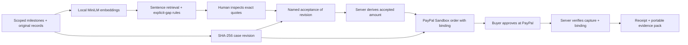

# Architecture and decision boundaries

## AI boundary

The model embeds each criterion and each source sentence. Normalized vectors are compared by dot product. Relevant explicit incomplete statements are flagged by deterministic rules; conditional statements and simple negated-gap phrases are excluded from that flag. Quotes are extracted from sources, never generated. The server's payment authorization does not consume a model completion or trust a model score.

## Payment boundary

The browser selects milestone IDs. It cannot set payable amounts or currency. Every selected milestone needs an acceptance bound to the current revision. The binding includes the case, revision, sorted selection, acceptances, amount and currency. Its SHA-256 value is placed in PayPal `custom_id`.

Capture requests are permitted only for orders stored in the same session. The reviewed revision and binding are checked before sending the capture request. Editing evidence or acceptance is blocked while a capture attempt is in progress. The returned order ID, completed status, `custom_id`, single capture, amount and currency are checked. Unknown outcomes require review; they are not displayed as success.

## State and credentials

Browser: session cookie (HttpOnly, SameSite=Lax; Secure with HTTPS), CSRF token, currently displayed case. Server: session-scoped in-memory records and orders, cached OAuth token, local model. No PayPal secret is sent to the browser. The public session configuration exposes only the non-secret client ID and configuration status.

This is a single-process prototype. It does not implement durable storage, distributed locks, webhook reconciliation, account-linked authorization or production key management. A production payment application needs all of those and a separate security review.

## Export boundary

The exported body has a canonical SHA-256 digest. Each event also references the previous event hash. The verifier detects edits relative to the original digest, event deletion/reordering and mismatch with the case revision. It does not prove that input statements were true, that the named reviewer is genuine, or that the recorded time comes from an independent clock.
